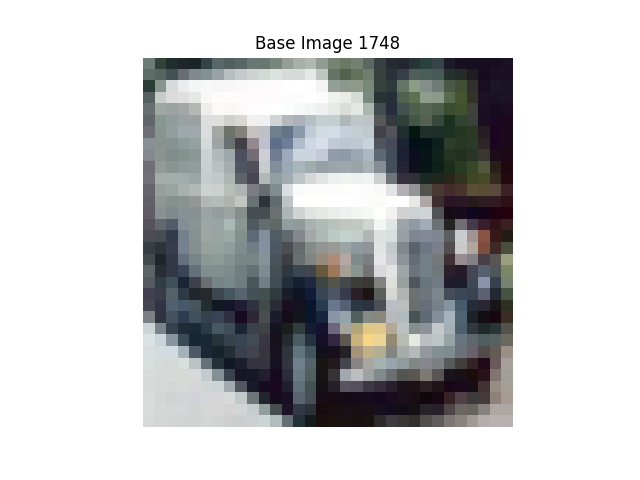
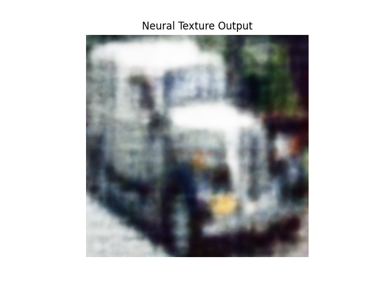

# Neural Image Upscaling

A PyTorch project that learns a coordinate-based representation of an image and renders it at a higher resolution using Fourier feature encoding.

## Implementation

- [fibonacci_coordinate_upscaling.py](./fibonacci_coordinate_upscaling.py) — Uses Fibonacci-inspired Fourier features to encode image coordinates and an MLP to predict RGB values.

## Results

**Input Image (32 × 32)**

**Upscaled Output**

## Notes

- Uses individual images from the CIFAR-10 dataset.
- The output is generated from the learned coordinate-to-RGB mapping. It does not recover image details absent from the original input.